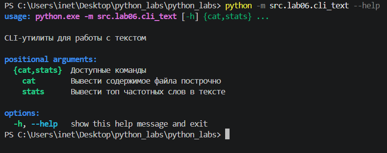
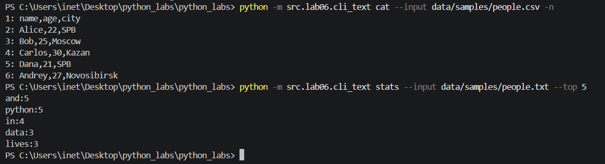
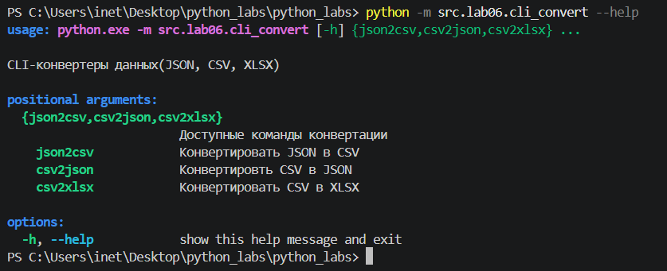
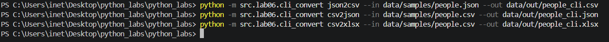

# ЛР6 — CLI‑утилиты с argparse (cat/grep‑lite + конвертеры):

## Описание модулей, подкоманд и параметров

### Подкоманды и параметры CLI
* **`cat`** — построчный вывод содержимого файла в консоль:
  * `--input <путь>` *(обязательный)* — путь к входному файлу.
  * `-n` *(флаг, необязательный)* — добавляет нумерацию строк при выводе (начиная с 1).
* **`stats`** — анализ частотности слов в тексте (на базе `normalize`, `tokenize`, `count_freq`, `top_n` из ЛР3):
  * `--input <путь>` *(обязательный)* — путь к входному текстовому файлу.
  * `--top <число>` *(необязательный, по умолчанию `5`)* — количество наиболее часто встречающихся слов.

### Описание функций модуля
* **`cmd_cat(path: str, number_lines: bool) -> None`**
  * **Что делает:** открывает файл в кодировке `UTF-8` и построчно выводит его содержимое в стандартный поток вывода (`stdout`), добавляя номер строки при включённом флаге.
  * **Входные параметры:** `path` — путь к файлу; `number_lines` — булев флаг (`True` — печатать с номерами строк, `False` — без номеров).
  * **Вывод / результат:** возвращает `None`; печатает строки файла в терминал. Выбрасывает `FileNotFoundError`, если файл не найден.

* **`cmd_stats(path: str, top: int) -> None`**
  * **Что делает:** считывает текст из файла, нормализует его, разбивает на токены, подсчитывает частоту слов и выводит `top` самых частых слов в формате `слово: количество`.
  * **Входные параметры:** `path` — путь к текстовому файлу; `top` — целое положительное число выводимых слов.
  * **Вывод / результат:** возвращает `None`; печатает рейтинг слов в терминал. Выбрасывает `FileNotFoundError`, если файл не найден.

* **`main() -> None`**
  * **Что делает:** настраивает парсер аргументов `argparse` с подкомандами `cat` и `stats`, валидирует значение `--top > 0` и запускает соответствующую функцию-обработчик.
  * **Входные параметры:** аргументы командной строки (`sys.argv`).
  * **Вывод / результат:** возвращает `None`; управляет выполнением CLI-команды или выводит справку/сообщение об ошибке парсера.


### 1. `src/lab06/cli_text.py` — консольная утилита для работы с текстом
* **`cat`** — построчный вывод содержимого файла в консоль (на базе функций работы с файлами).
  * `--input <путь>` *(обязательный)* — путь к входному файлу.
  * `-n` *(флаг, необязательный)* — добавляет нумерацию строк при выводе (начиная с 1).
* **`stats`** — анализ частотности слов в тексте (на базе функций `normalize`, `tokenize`, `count_freq`, `top_n` из ЛР3).
  * `--input <путь>` *(обязательный)* — путь к входному текстовому файлу.
  * `--top <число>` *(необязательный, по умолчанию `5`)* — количество наиболее часто встречающихся слов для вывода.

```python
import argparse
from pathlib import Path
from src.lib.text import normalize, tokenize, count_freq, top_n


def cmd_cat(path: str, number_lines: bool) -> None:
    file_path = Path(path)
    if not file_path.exists():
        raise FileNotFoundError(f"Файл {path} не найден")

    with file_path.open("r", encoding="utf-8") as f:
        for idx, line in enumerate(f, start=1):
            text = line.rstrip("\r\n")
            if number_lines:
                print(f"{idx}: {text}")
            else:
                print(text)


def cmd_stats(path: str, top: int) -> None:
    file_path = Path(path)
    if not file_path.exists():
        raise FileNotFoundError(f"Файл {path} не найден")

    text = file_path.read_text(encoding="utf-8")
    tokens = tokenize(normalize(text))
    freqs = count_freq(tokens)
    top_words = top_n(freqs, top)

    for word, count in top_words:
        print(f"{word}: {count}")


def main() -> None:
    parser = argparse.ArgumentParser(description="CLI-утилиты для работы с текстом")
    subparsers = parser.add_subparsers(dest="command", required=True, help="Доступные команды")

    cat_parser = subparsers.add_parser("cat", help="Вывести содержимое файла построчно")
    cat_parser.add_argument("--input", required=True, help="Путь к входному файлу")
    cat_parser.add_argument("-n", action="store_true", help="Нумеровать строки")

    stats_parser = subparsers.add_parser("stats", help="Вывести топ частотных слов в тексте")
    stats_parser.add_argument("--input", required=True, help="Путь к текстовому файлу")
    stats_parser.add_argument("--top", type=int, default=5, help="Количество топ-слов (по умолчанию 5)")

    args = parser.parse_args()

    if args.command == "cat":
        cmd_cat(args.input, args.n)
    elif args.command == "stats":
        if args.top <= 0:
            parser.error("Параметр --top должен быть положительным целым числом")
        cmd_stats(args.input, args.top)


if __name__ == "__main__":
    main()
```

### 2. `src/lab06/cli_convert.py` — CLI-обёртка над конвертерами из ЛР5
* **`json2csv`** — конвертация из JSON в CSV (вызывает `json_to_csv`).
* **`csv2json`** — конвертация из CSV в JSON (вызывает `csv_to_json`).
* **`csv2xlsx`** — конвертация из CSV в XLSX (вызывает `csv_to_xlsx`).
* Общие параметры для всех трёх подкоманд:
  * `--in <путь>` *(обязательный)* — путь к входному файлу.
  * `--out <путь>` *(обязательный)* — путь для сохранения результирующего файла.

### Подкоманды и параметры CLI
* **`json2csv`** — конвертация из JSON в CSV (вызывает `json_to_csv`).
* **`csv2json`** — конвертация из CSV в JSON (вызывает `csv_to_json`).
* **`csv2xlsx`** — конвертация из CSV в XLSX (вызывает `csv_to_xlsx`).
* Общие обязательные параметры для каждой подкоманды:
  * `--in <путь>` — путь к входному файлу.
  * `--out <путь>` — путь для сохранения выходного файла.

### Описание функции модуля
* **`main() -> None`**
  * **Что делает:** создаёт парсер `argparse` с тремя подкомандами (`json2csv`, `csv2json`, `csv2xlsx`), считывает пути из флагов `--in` (`args.input`) и `--out` (`args.output`) и делегирует выполнение соответствующей функции конвертации из `src/lab05/`.
  * **Входные параметры:** аргументы командной строки (`sys.argv`).
  * **Вывод / результат:** возвращает `None`; создаёт конвертированный файл по указанному в `--out` пути.


```python
import argparse
from src.lab05.json_csv import json_to_csv, csv_to_json
from src.lab05.csv_xlsx import csv_to_xlsx


def main() -> None:
    parser = argparse.ArgumentParser(description="CLI-конвертеры данных (JSON, CSV, XLSX)")
    subparsers = parser.add_subparsers(dest="cmd", required=True, help="Доступные команды конвертации")

    p1 = subparsers.add_parser("json2csv", help="Конвертировать JSON в CSV")
    p1.add_argument("--in", dest="input", required=True, help="Путь к входному JSON-файлу")
    p1.add_argument("--out", dest="output", required=True, help="Путь к выходному CSV-файлу")

    p2 = subparsers.add_parser("csv2json", help="Конвертировать CSV в JSON")
    p2.add_argument("--in", dest="input", required=True, help="Путь к входному CSV-файлу")
    p2.add_argument("--out", dest="output", required=True, help="Путь к выходному JSON-файлу")

    p3 = subparsers.add_parser("csv2xlsx", help="Конвертировать CSV в XLSX")
    p3.add_argument("--in", dest="input", required=True, help="Путь к входному CSV-файлу")
    p3.add_argument("--out", dest="output", required=True, help="Путь к выходному XLSX-файлу")

    args = parser.parse_args()

    if args.cmd == "json2csv":
        json_to_csv(args.input, args.output)
    elif args.cmd == "csv2json":
        csv_to_json(args.input, args.output)
    elif args.cmd == "csv2xlsx":
        csv_to_xlsx(args.input, args.output)


if __name__ == "__main__":
    main()
```

## Реальные примеры запуска

Вызов справки (`--help`):
```bash
python -m src.lab06.cli_text --help
python -m src.lab06.cli_convert --help
```

Работа с текстом (`cat` и `stats`):
```bash
python -m src.lab06.cli_text cat --input data/samples/people.csv -n
python -m src.lab06.cli_text stats --input data/samples/people.txt --top 5
```

Конвертация файлов через CLI:
```bash
python -m src.lab06.cli_convert json2csv --in data/samples/people.json --out data/out/people_cli.csv
python -m src.lab06.cli_convert csv2json --in data/samples/people.csv --out data/out/people_cli.json
python -m src.lab06.cli_convert csv2xlsx --in data/samples/people.csv --out data/out/people_cli.xlsx
```

## Скриншоты работы







